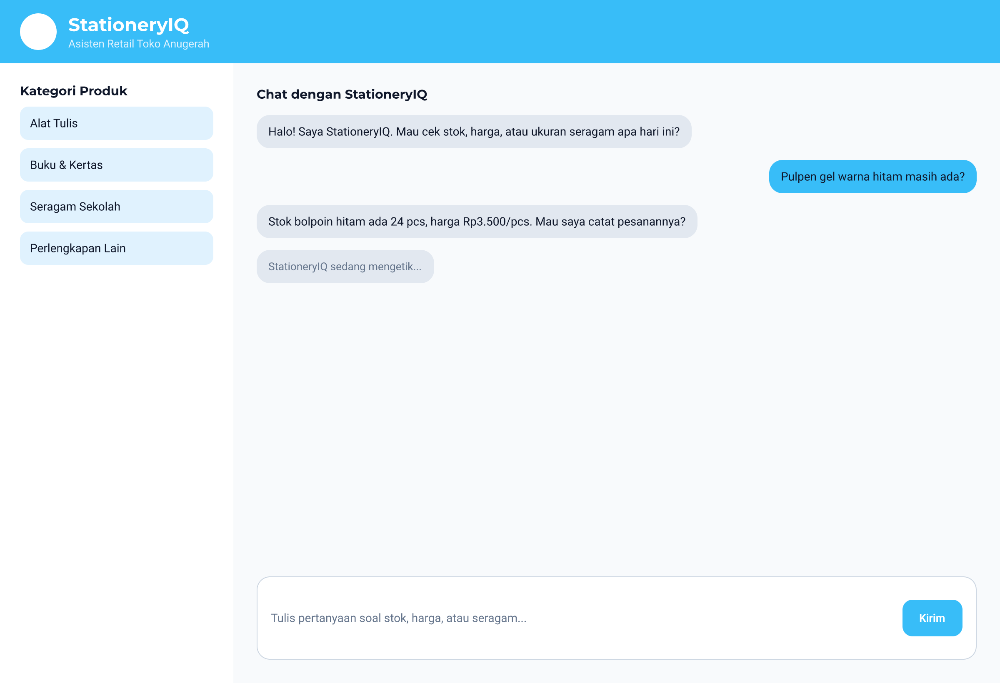

# StationeryIQ — Retail Copilot Chatbot (Toko Anugerah)

Chatbot untuk toko ATK dan seragam sekolah **Toko Anugerah**. Menjawab pertanyaan **stok, harga, dan ukuran/varian seragam** dalam bahasa sehari-hari, dirancang untuk pengguna non-teknis (pemilik toko, kasir, staf).

- **Durasi MVP:** 20 Nov – 20 Des 2026 (4 minggu)
- **Milestone akhir:** Live demo & UAT dengan pemilik toko, 20 Des 2026
- **Tim:** 6 orang, 3 path (Data Scientist, GenAI Engineer, Full Stack Developer)

## Arsitektur

```
Web Client (frontend)
      ⇅
API Backend (FastAPI)
      ⇅
RAG Engine (modul GenAI)
      ⇅
Database inventaris (PostgreSQL / SQLite)
```

## Tech Stack

| Bagian | Teknologi |
|---|---|
| Backend | FastAPI (Python), router async |
| Database | PostgreSQL / SQLite (skema dirancang path DS) |
| Frontend | Web app dengan chat UI (framework TBD) |
| Desain | FigCraft/Figma, font **Montserrat** & **Roboto** |
| Kolaborasi | GitHub (branch protection `main`), Kanban board, CI/CD dasar |

## Status — Minggu 1 (20–27 Nov)

Target **M1**: skeleton backend/frontend berjalan, repo + CI/CD dasar, wireframe disepakati.

| ID | PIC | Status | Tugas |
|---|---|---|---|
| TSK-FS-01 | Rafi | Berjalan | Setup repo GitHub, branching, environment, board tugas |
| TSK-FS-02 | Rizki | Berjalan | Wireframe UI chat + skeleton FastAPI & frontend |

### Desain

Wireframe chat UI (non-teknis, warna utama **biru muda**):



- Warna utama: `#38BDF8` (biru muda)
- Font: Montserrat (heading), Roboto (body)
- Teks antarmuka: Bahasa Indonesia yang ramah

## Struktur Repo

```
.
├── backend/                        # FastAPI (skeleton)
│   ├── main.py                     # endpoint: health, stok, kategori, chat (mock)
│   ├── test_api.py                 # cek cepat (pytest)
│   └── requirements.txt
├── frontend/                       # chat UI (skeleton, tanpa build step)
│   ├── index.html
│   ├── styles.css
│   └── app.js
├── docs/
│   └── design/                     # Aset desain (wireframe, mock)
├── README.md
├── ROLE_FULLSTACK_DEVELOPER.md     # Konteks role & task FSD
└── Roadmap & Task Breakdown ...xlsx  # Roadmap & task tracker
```

## Menjalankan (dev)

Backend:
```bash
cd backend
python -m venv .venv && .venv/Scripts/activate   # Windows; pakai bin/activate di Linux/macOS
pip install -r requirements.txt
uvicorn main:app --reload                        # http://127.0.0.1:8000
pytest                                           # cek cepat
```

Frontend (skeleton statis): buka `frontend/index.html` di browser, atau jalankan server statis:
```bash
cd frontend
python -m http.server 5500
```
`app.js` memanggil API di `http://127.0.0.1:8000` (ubah `API_BASE` bila perlu).

## Endpoint Minimum (rencana)

- `GET /health` — health check
- `GET /stok` — daftar stok produk
- `GET /kategori` — daftar kategori
- `POST /chat` — kirim pertanyaan, terima jawaban RAG

## Aturan Kontribusi

- Jangan push langsung ke `main` (branch protection aktif). Gunakan branch + Pull Request.
- Prioritaskan task berstatus **Tinggi** dan yang dekat checkpoint milestone.
- Kontrak antar-path (format JSON katalog, payload RAG) disepakati dengan PIC Data Scientist & GenAI Engineer sebelum diubah.
